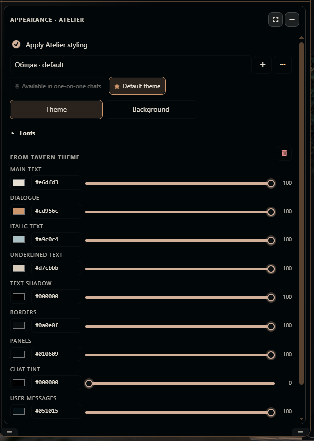

# Atelier 

Atelier remembers the look of each character's chat and applies it when you switch characters.

Atelier works with your existing SillyTavern theme, including Moonlit Echoes. It captures appearance settings so you can reuse them across character cards.

Open **⋯ → Interface language** and choose **English** or **Русский**. Atelier saves your choice in SillyTavern's settings. Theme names and filenames appear as written.

## Getting started

1. Set up your appearance as usual in SillyTavern and in your theme.
2. Export a theme using **UI Theme** in SillyTavern or the preset export button in Moonlit Echoes.
3. In Atelier, open **⋯ → Import from file…**. You can import both files. The SillyTavern theme contributes text colors, tints, borders, and font settings. The Moonlit preset contributes accent colors, the chat window background, the top bar, the scrollbar, sizes, and spacing. When you import the second file, choose whether to add it to the open theme or create a new one.
4. Choose a background, click **Save** if you made changes, and use **Assign · [character name]** to assign the theme to the current character.

Open the character's chat and Atelier applies the saved appearance automatically.

## How themes work

An Atelier theme has a name, a set of CSS variables, and a background. The editor shows the settings available in your imported file or captured from the current page. Use the color swatch and opacity slider for colors, or the text field for other values.

You can assign one theme to several characters. Changes to a shared theme apply to every character that uses it. Use **⋯ → Duplicate** to make a separate copy. The star button marks a **Default theme** for characters without an assigned theme.

Atelier identifies character cards by their avatar filenames, so two cards named “Law” can have separate themes.

## Import formats

| File | Recognized by | What Atelier imports |
| --- | --- | --- |
| SillyTavern UI theme | `main_text_color` | Ten `--SmartTheme*` colors and supported CSS variable declarations from `custom_css` |
| Moonlit Echoes preset | `moonlitEchoesPreset` | Supported string values from `settings` as `--<key>` variables |
| Atelier theme | `format: wani-atelier` | The theme's saved values and background |

Chat width, message layouts, avatar styles, theme toggles, and `rawCustomCss` remain global settings. Atelier validates CSS values before applying them and rejects semicolons, braces, comments, and `@import`.

## Installation

Place the `sillytavern-atelier` folder in `SillyTavern/public/scripts/extensions/third-party/` and reload the page. Turn on **Apply Atelier styling** to activate your assigned themes. Turn the same checkbox off to restore your regular appearance.

With Roleplay Tools installed, Atelier appears on the **Appearance** page (**Оформление** in Russian).

## Upgrading from older versions

Atelier carries over colors, tint opacity, font settings, and backgrounds from older versions. Migration drops older message and portrait layout overrides.

## Scope

Your SillyTavern theme controls portrait placement and size, message layouts, chat width, and the appearance of panels. Character catalogs are handled by a separate extension. Group chats use the default Atelier theme.

## Fonts

Open **Theme → Fonts** in any editable theme to choose regular and monospace fonts. The controls are available even when the imported theme has no font settings.

- **Find a font…** filters the list. Selecting a font updates the sample text and the theme preview immediately. The **Font name** field accepts a CSS font stack such as `"Georgia", serif`. **Reset** clears the font override.
- **From this computer** asks for browser permission when you click it. The button needs a browser and address that support the Local Font Access API. You can still enter a font name or upload a file. The common fonts list includes familiar font names and system defaults.
- **Upload font** accepts TTF, OTF, WOFF, and WOFF2 files up to 10 MB. Uploading works without installing the font in Windows. Atelier shows the filename in the list and assigns the uploaded font a unique name so it can coexist with a system font of the same name. Each font file is a separate entry. Cyrillic support depends on the font.
- Click **Save** to keep the font selection for the current theme. Atelier stores the uploaded file immediately and makes it available to other themes in the same browser.
- Uploaded files live in IndexedDB for the current SillyTavern address. They survive a reload. They stay in the current browser and can be removed when site data is cleared. Theme JSON references the font by name. On another device, upload the original font file, choose it in the imported theme, and save the theme again.
- **Delete file** removes the selected uploaded font. If a saved theme or another draft uses it, select a replacement in those themes and save them first. To remove an unused file, select it and click **Delete file** before saving that temporary selection.

## Tests

- `npm run check` checks JavaScript syntax.
- `npm run test:fonts` runs the font tests using simulated storage and `FontFace`. A browser is only needed to verify how a font renders.
- `npm test` includes tests for theme import, merging values, CSS validation, migration, and background fallbacks. The full suite requires the theme samples in `tests/fixtures`, which are currently missing from the repository.
